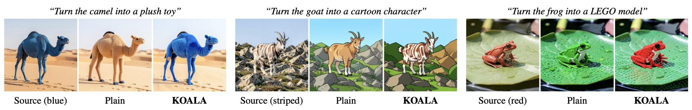
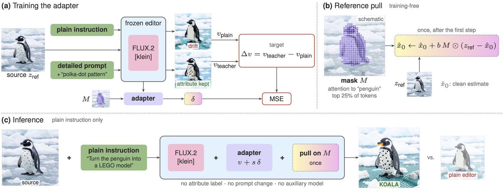

<div align="center">

# KOALA: Keeping Original Attributes via Latent Anchoring

**Nina Konovalova** · **Diaa Abuhani**

[Dataset](https://huggingface.co/datasets/NinaK/shift_dataset) · Paper (coming soon) · [Citation](#citation)



*FLUX.2 [klein] 4B applies the edit but replaces the subject's rare attribute with the typical one (Plain).
KOALA keeps the attribute with the same plain instruction, no attribute label and no auxiliary model.*

</div>

## Abstract

Context-based editors such as FLUX.2 [klein] 4B edit reference images out of the box, without retraining or image
inversion. However, even when they correctly apply the requested edit, they often replace a subject's rare attribute
with its typical value. We study this rare-attribute drift across multiple editing tasks and how to undo it without
additional large models. We introduce KOALA (Keeping Original Attributes via Latent Anchoring) with two components: a
small correction adapter and a local reference pull. We train the adapter to predict a velocity correction from the
editor's own plain velocity at every denoising step, without an additional editor forward pass. The local reference
pull acts once on the subject's tokens, right after the first denoising step. Both components use the editor's
attention mask and require no auxiliary model or attribute label at inference. On exploratory validation, KOALA
achieves a higher Success rate than plain instructions and a comparable rate to detailed label-based prompts.

## Method

<p align="center"></p>

- **(a) Correction adapter.** A per-token MLP on the frozen editor's output, trained to predict the velocity correction
  that a detailed label-based prompt would make, `Δv = v(detailed) − v(plain)`, at states of plain-instruction rollouts.
  The loss is item-balanced MSE over all image tokens, normalised per step. The mask `M` is an input, not a loss weight.
- **(b) Reference pull.** Once, right after the first Euler step, the subject's clean estimate is pulled towards the
  source latent: `x₁ ← x₁ + b(1 − σ₁) M ⊙ (z_ref − x̂₀)`, with `x̂₀` from the plain velocity.
- **(c) Inference.** The plain instruction only: `v + s·δ` at every step, plus edit guidance `g(v − v∅)` at steps 1–3.
  `M` is the top 25% of image tokens by attention to the subject word (single-stream blocks S13–S19, first forward pass).
  Final setting `s = 2, b = 2, g = 1`, 7 editor forwards, no attribute label, no prompt change.

## Results

Method validation at a fresh seed: 236 pairs in 36 subject clusters (pose excluded), judge 1 (Qwen2.5-VL-7B).

| Method | Success ↑ | Edit ↑ | Control ↑ | Drift ↓ |
|---|:-:|:-:|:-:|:-:|
| Plain instruction | 0.14 | **0.98** | **0.96** | 0.825 |
| Detailed prompt (label-based oracle) | **0.79** | 0.91 | <u>0.92</u> | **0.105** |
| LoRA, rank 4 | 0.64 | <u>0.94</u> | <u>0.92</u> | 0.281 |
| SDEdit, skip 1 step | 0.41 | 0.74 | 0.73 | 0.378 |
| **KOALA** (`s=2, b=2, g=1`) | <u>0.75</u> | 0.90 | 0.86 | <u>0.111</u> |

**Success:** rare view kept (`P(rare)` at least half the source's) and edit applied. **Edit:** edit applied.
**Control:** common view applied and still typical. **Drift:** mean rare drop minus mean common rise.
The setting was chosen on this validation population, so these numbers are exploratory. The KOALA test part has not
been read yet.

## Setup

One GPU with at least 40 GB (an A6000 was used), Python 3.10.

```bash
python -m venv .venv && source .venv/bin/activate
pip install -r requirements.txt
cd code
hf download NinaK/shift_dataset --repo-type dataset --local-dir data   # gated: request access first
```

Models are downloaded on first use: `black-forest-labs/FLUX.2-klein-4B` (editor), `Qwen/Qwen2.5-VL-7B-Instruct`
(judge 1) and `Qwen/Qwen3-VL-8B-Instruct` (judge 2). All scripts run from `code/`.

## Run KOALA validation

The trained adapter is shipped in [`weights/koala_adapter.pt`](weights/koala_adapter.pt)
(md5 `7563d0b067bc64831ae1e25952c5d67c`).

```bash
cd code
python koala.py --ckpt ../weights/koala_adapter.pt --part val --seed_kind fresh
```

The script edits both views of every pose-free validation pair with the plain instruction and with KOALA, scores them
with judge 1 and prints Success, Edit, Control and Drift for both. It writes per-case scores to
`koala_val/results.parquet` and 256 px previews to `koala_val/img/`. Use `--s`, `--b` and `--g` to change the adapter
strength, the pull strength and the edit guidance. `judge.py` words its questions slightly differently from the
pipeline used for the table above, so expect close but not identical numbers.

## Train the adapter

```bash
cd code
python judge.py --split dev --out judge_dev.parquet      # teacher selection needs scores of both released splits
python judge.py --split test --out judge_test.parquet
python collect_adapter.py --shard 0 --nshards 2          # and --shard 1: teacher corrections in adapter_data/
python train_adapter.py --out adapter.pt                 # 3500 iterations, about 1 MB checkpoint
```

| Script | What it does |
|---|---|
| [`adapter.py`](code/adapter.py) | the adapter (MLP 658 → 256 → 256 → 128) and its Fourier position features |
| [`collect_adapter.py`](code/collect_adapter.py) | picks a teacher per pair, saves plain rollout states, plain velocities, `Δv` and the mask `M` |
| [`train_adapter.py`](code/train_adapter.py) | item-balanced, step-normalised MSE; AdamW, warm-up then cosine |
| [`koala.py`](code/koala.py) | KOALA inference and validation scoring |

The teacher is the detailed prompt when both of its edits pass (rare view kept and applied, common view applied and
typical), else the agent-written prompt when it passes, else the pair is dropped. The shipped adapter was trained on
2732 items of 62 training subjects (96% detailed teachers). Its teachers were chosen with our own judge wording, so a
rerun of `collect_adapter.py` can pick slightly different pairs and gives a similar, not identical, adapter.

## Splits

[`code/koala_split.json`](code/koala_split.json) re-splits the released dev + test pairs by subject into 63 training,
39 validation and 39 test subjects, keeping near-duplicate subjects together. It is not the release split:

- 542 release-test pairs are KOALA training data, so do not score KOALA on the release test cases of Table 1 below.
- The KOALA validation and test parts contain release-dev pairs (36 of 241 and 54 of 242), on which the release-dev
  methods below were tuned.

## Repository layout

```
assets/    README figures
code/      all scripts (run from this folder; they read data/ and write next to themselves)
paper/     LaTeX source, figures, tables and the PDF of the earlier short paper
results/   per-case judge scores (parquet/csv) behind every table and figure of the short paper
weights/   the trained KOALA adapter
```

## Analysis of the drift (earlier short paper)

The analysis code comes from the short paper **"Rare Attributes Are Lost in the Text Stream: Prior-Driven Drift in
Reference-Based Editing with FLUX.2 [klein]"** ([`paper/main.pdf`](paper/main.pdf)). It locates where the drift happens
and tests fixes that leave the prompt unchanged on the release split.

| Finding | Number | Where |
|---|---|---|
| Vanilla edits that lose the rare attribute (dev, dataset seed) | 84% | Sec. 2 |
| Detailed prompt at steps 0-1 only restores it | 97% | Fig. 1a |
| Model's own activations name the reference's rare attribute (unseen subjects, top-1 / top-3) | 69% / 92% | Sec. 3 |
| Held-out test, clean success: detailed / minimal prompt | 92% / 87% | Table 1 |
| Held-out test: hidden-state steering (no prompt change) / LoRA (no label) | 71% / 47% | Table 1 |
| Exact patch of the image tokens at S4-S12 (oracle) vs. detailed prompt | 61% vs. 99% | Fig. 3 |
| Best label-free, training-free method (dev) | 57% | Table 3 |

### Rebuilding the short paper's tables and figures from the shipped results

```bash
cp -r results/* code/ && cd code && python make_paper.py   # writes code/paper/figs and code/paper/tables
```

This reproduces all four tables exactly and the figures except the example images, which need the dataset and the
generated images (not in the repo); without them that figure is skipped.

### Running the experiments

Scripts are listed in the order they depend on each other. Each one has a docstring with its arguments.

| Step | Script | Produces | Paper |
|---|---|---|---|
| Core | `velocity.py` | manual 4-step edit loop with access to the velocity | all |
| | `hidden.py`, `attn_mask.py` | hooks on the 25 blocks; subject mask from attention to the subject word | all |
| | `judge.py`, `judge2.py` | VLM judges (Qwen2.5-VL-7B, Qwen3-VL-8B) | all |
| 1. Drift | `judge.py --split dev --out judge_dev.parquet`, then `drift_table.py` | `judge_dev.parquet`, `drift_table_dev.parquet` | Sec. 2 |
| 2. Analysis | `exp_step0.py`, `analyze_step0.py` | step swap | Fig. 1a |
| | `collect_dv.py`, `collect_h.py`, `analyze_h.py` | corrections per step and block, `layer_scores.csv` | Fig. 1b |
| | `refdir_collect.py`, `refprobe.py`, `ridge_cos2.py` | attribute read from reference activations | Sec. 3 |
| 3. Test | `steer_final.py --mode test`, `rescore_defects.py` | hidden / velocity steering | Table 1 |
| | `baselines.py`, `analyze_baselines.py` | prompt, guidance, SDEdit, attention baselines | Table 1-2 |
| | `train_lora.py`, `eval_lora.py`, `analyze_lora.py` | velocity-matching LoRA | Table 1-2 |
| | `score2_test.py`, `judge2_table.py` | second-judge rescoring | Table 1 |
| 4. Ceiling (dev) | `ladder.py` | exact and low-rank patching oracles | Fig. 3 |
| | `steer2.py`, `depth.py` (+ `analyze_*.py`) | own-vector oracle, block ranges, label-free directions | Fig. 3, Table 3 |
| 5. Label-free (dev) | `sdedit_plus2.py`, `score2_sdedit.py` | SDEdit and source injection | Table 3, App. |
| | `text_steer.py`, `refguid.py`, `txtref.py` | text-token steering, reference guidance, attention boost | Table 3 |
| Paper | `make_paper.py` | figures and tables | all |

### Protocol

Every method choice of the short paper was made on the release dev split. The release test split (70 subjects) was
used for two evaluation rounds (steering with baselines, then the LoRA) and for rescoring the same images with the
second judge. Scores come from VLM judges; the two judges agree on "attribute kept" (kappa 0.76) but less on "edit
applied" (kappa 0.46).

## Citation

```bibtex
@misc{konovalova2026koala,
  title  = {{KOALA}: Keeping Original Attributes via Latent Anchoring},
  author = {Konovalova, Nina and Abuhani, Diaa},
  year   = {2026}
}
```

## Related

This work follows [SHIFT: Steering Hidden Intermediates in Flow Transformers](https://arxiv.org/abs/2604.09213)
(Konovalova, Idrisov, Alanov, 2026), which steers FLUX.1 for concept control in text-to-image generation.
